[English](README.en.md) | **Русский**

# Пресет Nilesoft Shell: FFmpeg в контекстном меню

Моя личная настройка правой кнопки мыши в Проводнике Windows. Главное в ней — **меню FFmpeg**:
конвертация, сжатие, обрезка и исправление видео, звука и картинок в пару кликов, в том числе быстрое
кодирование на видеокартах NVIDIA, AMD и Intel. Плюс 11 тем оформления на выбор, поиск в Everything, хэши, массовое переименование, ссылка на файл, образы дисков, питание и многое другое.
Меню есть на русском и на английском. Что делает каждый пункт — в [MENU.md](MENU.md).

Сделано и проверено на **Windows 11** и **Nilesoft Shell 1.9.18**.


## Как это выглядит

<p align="center">
  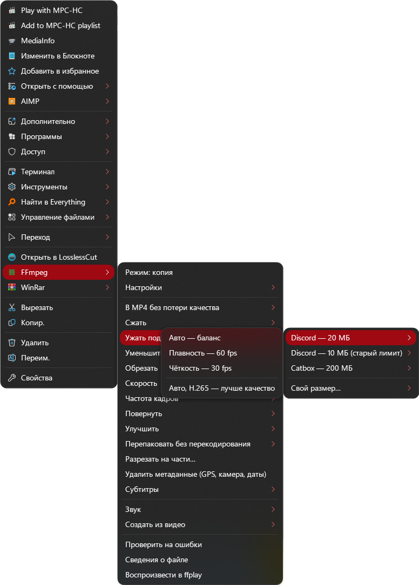
</p>
<p align="center">
  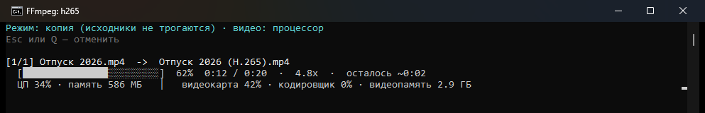
</p>

<details>
<summary><b>Ещё скриншоты</b> (нажми, чтобы открыть)</summary>

| | |
|---|---|
| Главное меню на видео<br>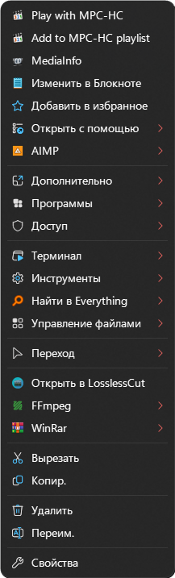 | FFmpeg<br>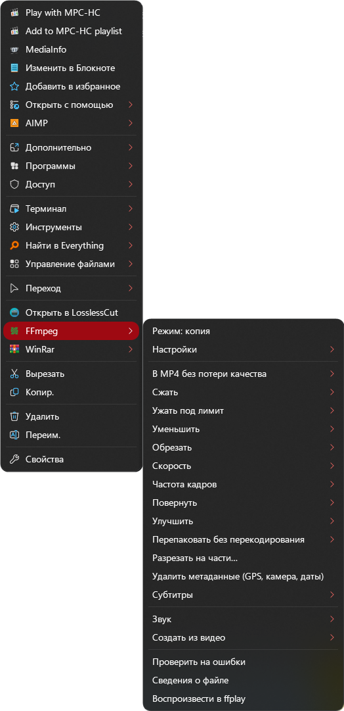 |
| Настройки FFmpeg (видеокарта)<br>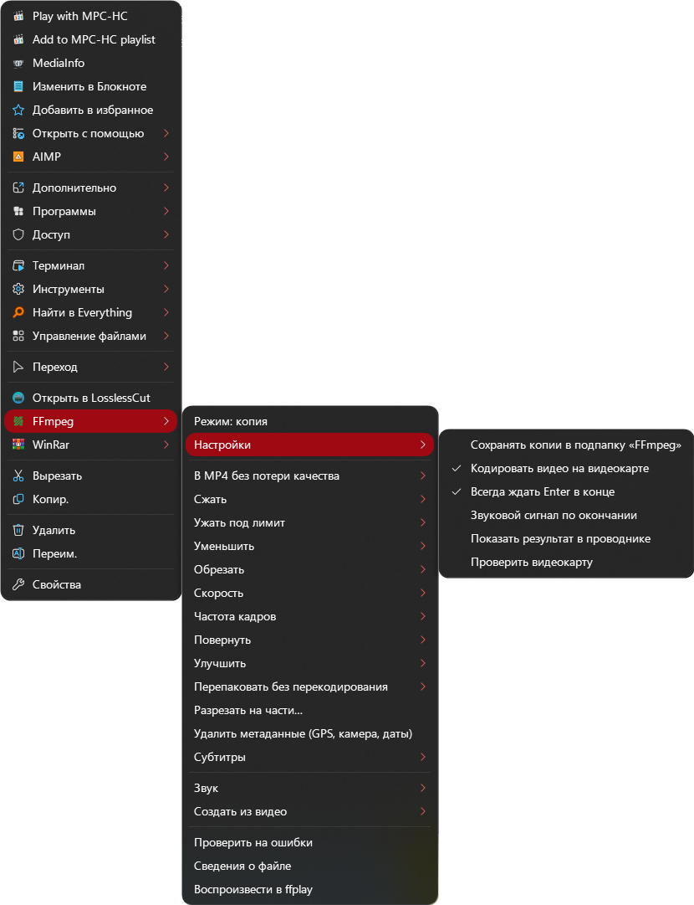 | Создать из видео: GIF, 9:16, кадры<br>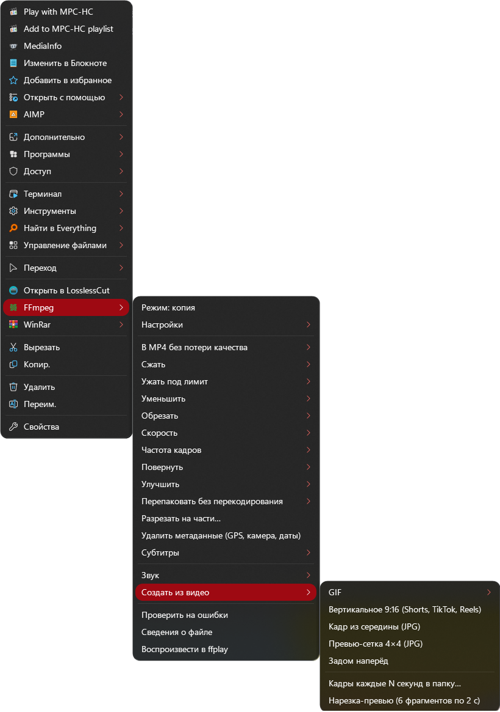 |
| Массовое переименование<br>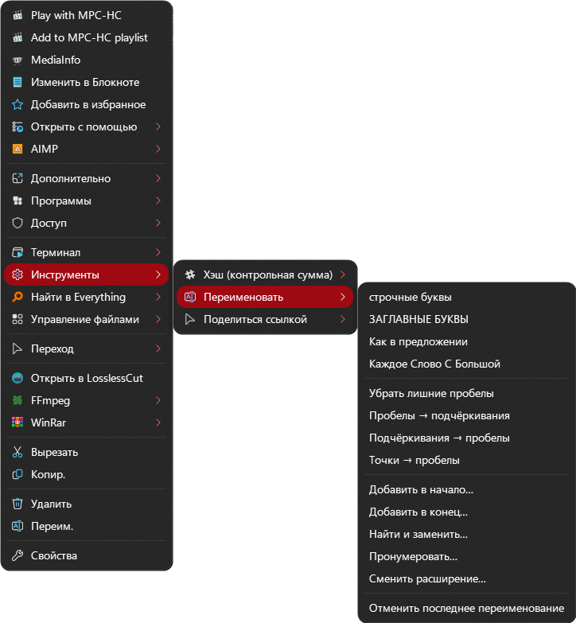 | Поиск в Everything<br>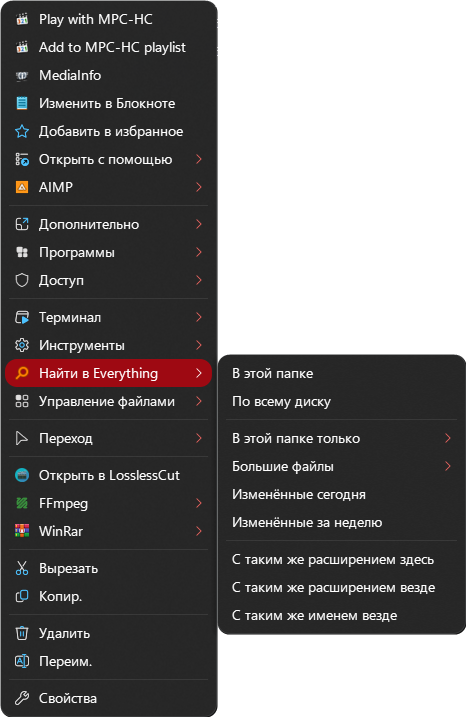 |
| Умное выделение<br>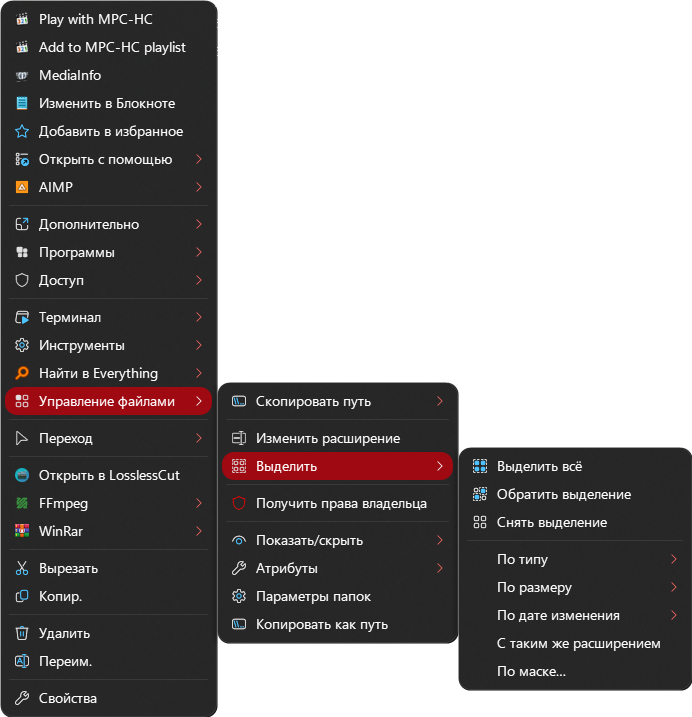 | |

</details>

## Темы

11 тем оформления: выбираются при установке и меняются в любой момент прямо из меню.

| | | | |
|---|---|---|---|
| Акрил (по умолчанию)<br>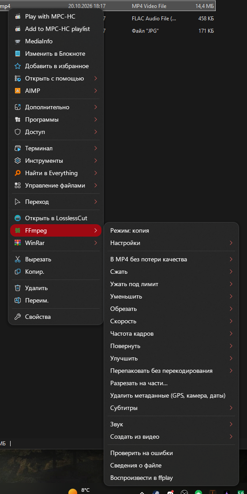 | Modern<br>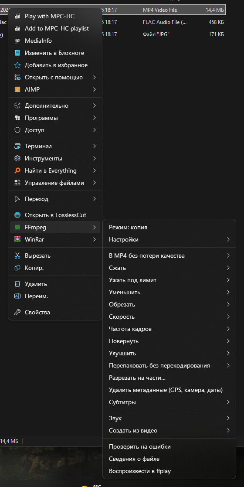 | Светлая<br>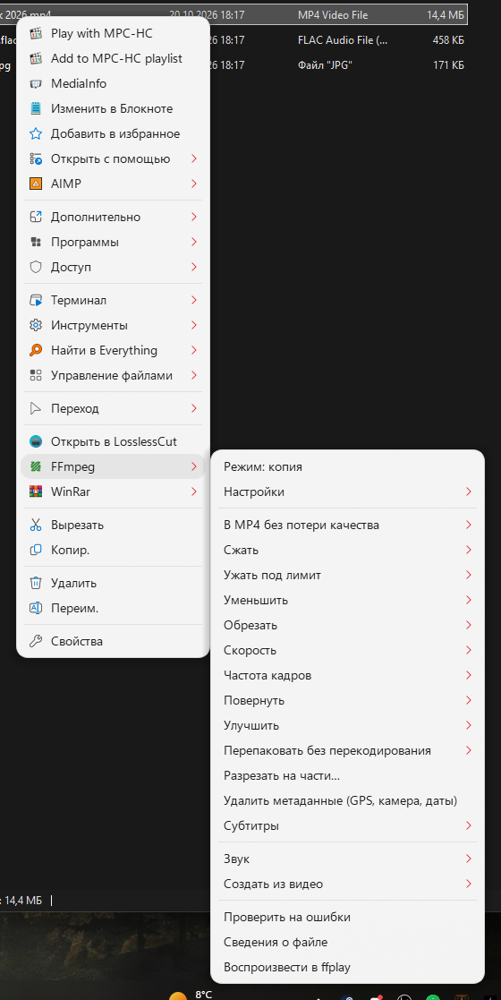 | Неон<br>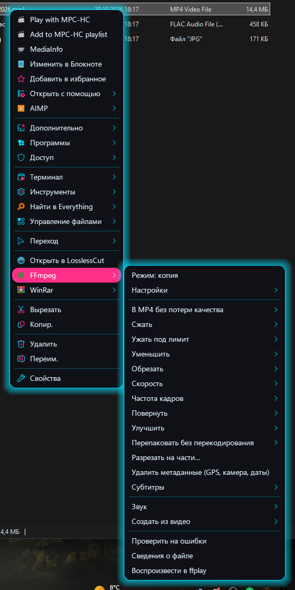 |
| Dracula<br>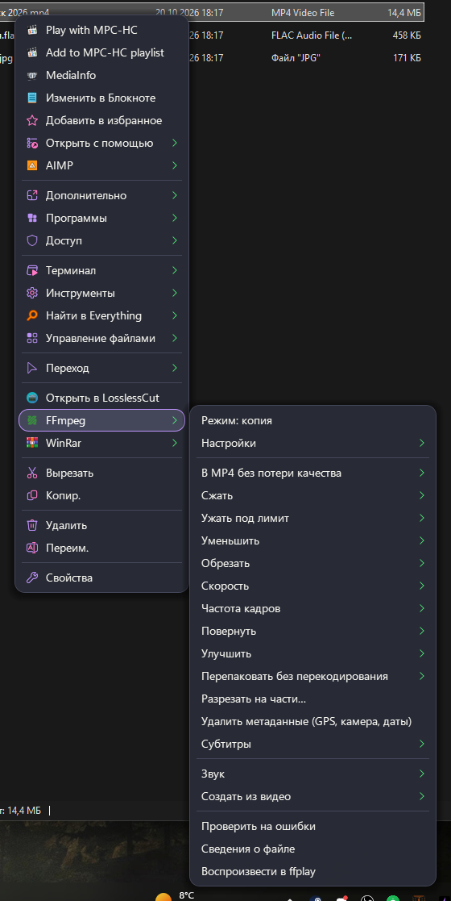 | Nord<br>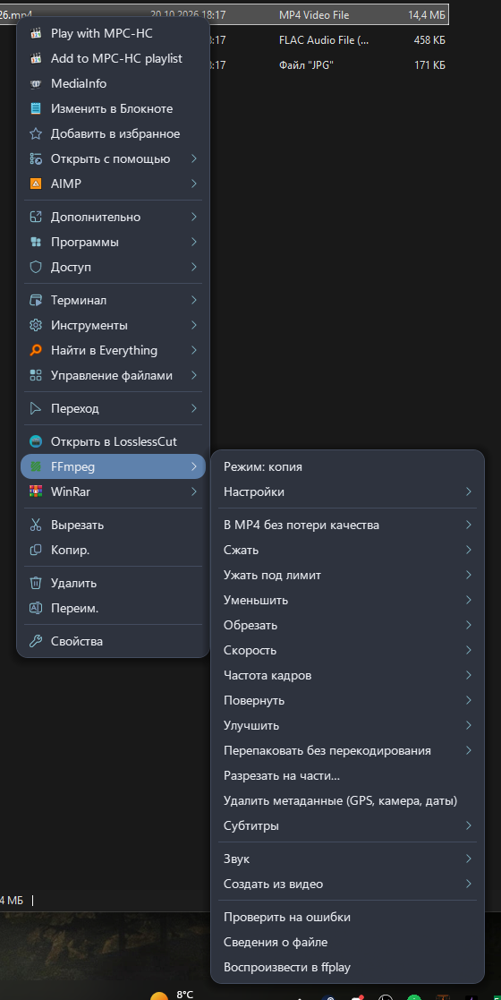 | Кодек<br>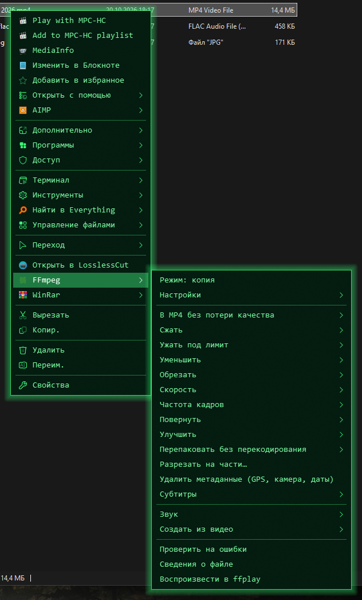 | Закат<br>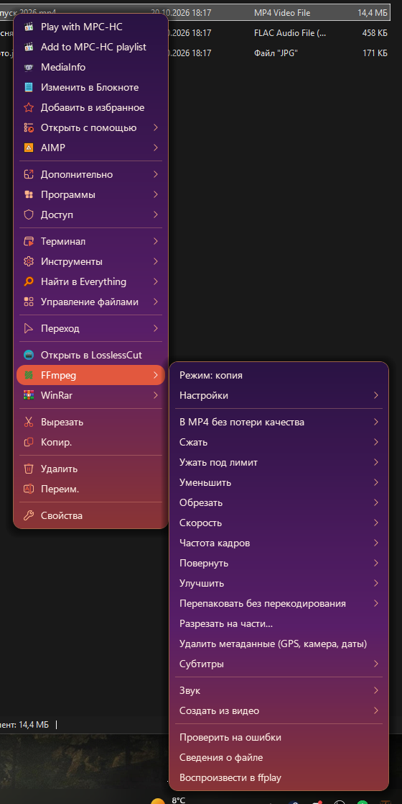 |
| macOS<br>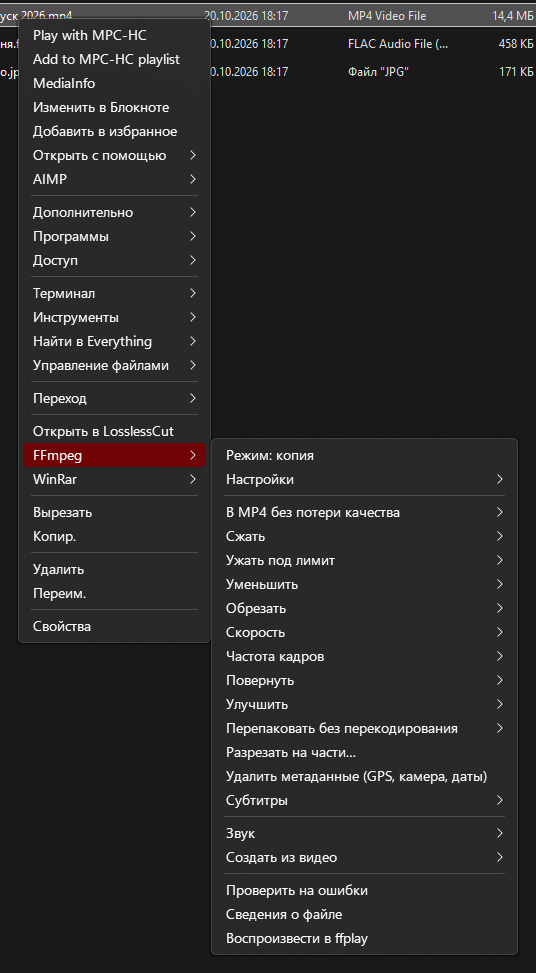 | Бирюзовое стекло<br>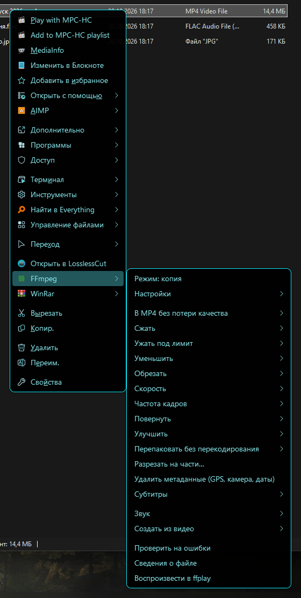 | Fluent<br>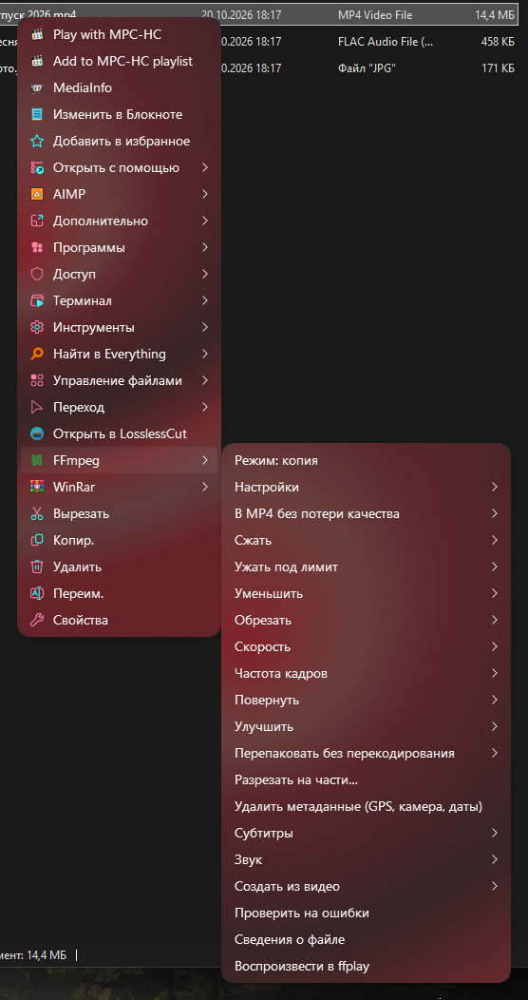 |  |

**Как сменить тему:**

- **Из меню**: Shift + правый клик по панели задач → **Nilesoft Shell → Тема** → выбери тему.
  Следующее меню откроется уже в ней, у текущей темы стоит галочка.
- **При установке**: `Install.cmd` спросит, какую тему включить. При переустановке он предложит ту, что стоит сейчас.
- **Вручную**: темы лежат в `imports/themes/`, по файлу на тему. Открой `shell.nss` Блокнотом и поменяй
  имя файла в строке `import 'imports/themes/acrylic.nss'`, например на `neon.nss`. Сохрани и сделай
  **Ctrl + правый клик** по рабочему столу — так Nilesoft перечитает настройки (перезапускать Проводник не нужно).

Имена файлов: `acrylic` (Акрил), `modern`, `light` (Светлая), `neon` (Неон), `dracula`, `nord`, `codec` (Кодек),
`sunset` (Закат), `macos`, `glass` (Бирюзовое стекло), `fluent`. Fluent красится в цвет акцента Windows
(Параметры → Персонализация → Цвета), поэтому у тебя он может быть не красным, а другого цвета.
Свою тему проще всего сделать из копии любой готовой: про настройки — в [документации Nilesoft](https://nilesoft.org/docs/configuration/themes).

---

## Что в папке

| Что | Зачем |
|---|---|
| `Install.cmd` | Автоматическая установка: запусти, и он сделает всё сам |
| `config/ru`, `config/en` | Сами файлы меню (`shell.nss` и папка `imports`) на русском и на английском |
| `setup/install.ps1` | Скрипт установки, его запускает `Install.cmd` |
| `MENU.md`, `MENU.en.md` | Описание всех пунктов меню |
| `CHANGELOG.md`, `CHANGELOG.en.md` | История изменений по версиям |
| `docs/screenshots` | Скриншоты для этого описания (в `themes/` — все темы) |
| `dev/` | Для тех, кто хочет переделывать меню: генераторы файлов, словарь перевода и проверялка |

Скачать: зелёная кнопка **Code → Download ZIP** на странице GitHub (или из раздела Releases),
распаковать архив **целиком** в любую папку.

---

## Шаг 0. Установи Nilesoft Shell

Без него меню не будет. На <https://nilesoft.org/download> есть два варианта, подходят оба:

- **Портативная версия** (`portable.zip`) — просто распакуй в любую папку, например `D:/APPS/Nilesoft Shell`.
  Ничего не устанавливается, регистрацию в Windows сделает установщик пресета. Подробнее — в разделе
  [Портативность](#портативность).
- **Обычная установка** — `setup-x64.msi`, или `winget install Nilesoft.Shell`, или `scoop install nilesoft-shell`.

Потом поставь нужные программы из [списка ниже](#какие-программы-нужны). Это необязательно:
без программы просто не будет её пунктов. Если поставишь позже, запусти установку пресета ещё раз.

## Способ 1. Автоматическая установка (проще)

1. Запусти **`Install.cmd`** и нажми «Да» на вопрос о правах администратора.
2. Выбери язык меню (по умолчанию — язык Windows) и [тему](#темы) (по умолчанию — Акрил).
3. Установщик сам:
   - найдёт папку Nilesoft Shell;
   - сохранит твоё старое меню в `Nilesoft Shell/backup/before-preset-<дата>`;
   - скопирует файлы пресета;
   - найдёт ffmpeg, Everything и LosslessCut и покажет, что нашёл. Enter — согласиться;
     можно ввести номер другого варианта или вставить свой путь;
   - проверит версию ffmpeg и то, умеет ли видеокарта кодировать видео;
   - напишет, какие пункты появятся, а какие будут скрыты и почему;
   - зарегистрирует Nilesoft Shell и перезапустит Проводник (панель задач моргнёт — это нормально).
4. Кликни правой кнопкой по файлу, папке, рабочему столу или панели задач.

> Если Windows покажет «Windows защитила ваш компьютер» — нажми «Подробнее» → «Выполнить в любом случае».
> Так Windows реагирует на любые скачанные `.cmd`. Установщик ничего не скачивает и ничего не отправляет
> в интернет: он только копирует файлы в папку Nilesoft Shell и пишет в ней пути к программам.

## Способ 2. Ручная установка

1. Открой папку Nilesoft Shell (где лежит `shell.exe`: обычно `C:/Program Files/Nilesoft Shell`, у портативной — куда распаковал). Сохрани куда-нибудь
   её файл `shell.nss` и папку `imports` — это твоё текущее меню.
2. Скопируй в папку Nilesoft Shell содержимое **`config/ru`** (или `config/en` для английского меню):
   файл `shell.nss` и папку `imports`, с заменой файлов. Windows попросит права администратора — соглашайся.
   Включена тема Акрил; другую можно выбрать сразу — как, написано в разделе [Темы](#темы).
3. Если программы стоят в необычных местах — открой `imports/paths.nss` Блокнотом
   и впиши пути (см. [Важно ли, куда установлены программы](#важно-ли-куда-установлены-программы)).
   Если программы стоят как обычно, ничего делать не нужно: меню найдёт их само.
4. Открой **терминал от имени администратора** в папке Nilesoft Shell и выполни:
   ```
   shell.exe -register -treat -restart
   ```
   (`-treat` отключает урезанное меню Windows 11, `-restart` перезапускает Проводник).
5. Если есть видеокарта Intel (или кодирование на видеокарте не появилось) — кликни правой кнопкой
   по любому видео → **FFmpeg → Настройки → Проверить видеокарту**.

---

## Какие программы нужны

| Программа | Для чего | Обязательна? | Где взять |
|---|---|---|---|
| **Nilesoft Shell** 1.9.18 или новее | Само меню | **Да** | <https://nilesoft.org/download> · `winget install Nilesoft.Shell` |
| **FFmpeg** 7.0 или новее | Меню «FFmpeg»: видео, звук, картинки | Нет | <https://www.gyan.dev/ffmpeg/builds/> · `winget install Gyan.FFmpeg` |
| **Everything** | Меню «Найти в Everything» | Нет | <https://www.voidtools.com/> · `winget install voidtools.Everything` |
| **LosslessCut** | Пункт «Открыть в LosslessCut» | Нет | <https://github.com/mifi/lossless-cut/releases> (архив для Windows) |
| **WinRAR** | Меню «WinRar» (распаковка и архивация) | Нет | <https://www.win-rar.com/> · `winget install RARLab.WinRAR` |
| Видеокарта **NVIDIA, AMD или Intel** с драйвером | Быстрое кодирование видео на видеокарте | Нет | Обычный драйвер видеокарты |
| VS Code, .NET SDK | Скрытое меню «Разработка» (Shift + правый клик) | Нет | Только для программистов |

Уже есть в Windows и ничего ставить не нужно: PowerShell 5.1, curl, проверка дисков, монтирование ISO.

### Какая версия FFmpeg нужна

- **FFmpeg 7.0 или новее.** Проверено на 8.0.1 и 9.0.2. На версиях 6.x и старше часть пунктов
  может не работать (например, поворот без перекодирования). Установщик предупредит, если версия старая.
- Нужна сборка **с x264 и x265** (так называемая GPL-сборка). Подходят обе сборки с gyan.dev —
  и `essentials`, и `full`: в них есть всё, что использует меню (x264, x265, AV1, WebP, стабилизация,
  кодировщики видеокарт). Сборки BtbN тоже подходят, но только вариант `gpl`, не `lgpl`.
  `winget install Gyan.FFmpeg` ставит полную сборку.
- Ручной вариант: скачай `ffmpeg-release-essentials.7z` (или `full`), распакуй куда угодно
  (например, `C:/ffmpeg`). Внутри будет папка `bin` с `ffmpeg.exe`, `ffprobe.exe` и `ffplay.exe`.

### Кодирование на видеокарте

Меню умеет кодировать видео на видеокарте — это в разы быстрее процессора:

| Видеокарта | Технология | Что нужно |
|---|---|---|
| NVIDIA GeForce GTX 900 и новее | NVENC | Свежий драйвер NVIDIA |
| AMD Radeon RX 400 и новее, процессоры Ryzen со встроенной графикой | AMF | Драйвер AMD Adrenalin |
| Intel: встроенная графика (Core 6-го поколения и новее), Intel Arc | Quick Sync | Драйвер Intel |

Видеокарта определяется сама: меню пробует закодировать полсекунды тестового видео и запоминает,
что сработало. H.265 умеют не все старые видеокарты — тогда для H.265 используется процессор.
Если видеокарты нет или она не умеет кодировать, пункты «на видеокарте» скрыты и всё делает процессор
(медленнее, но качество на мегабайт даже лучше).

Включается в меню: **FFmpeg → Настройки → Кодировать видео на видеокарте**.
После замены видеокарты или драйвера: **FFmpeg → Настройки → Проверить видеокарту**.

> Честно: кодирование на NVIDIA проверено на реальной видеокарте. Для AMD и Intel параметры
> проверены по документации и самим ffmpeg, но на настоящих видеокартах AMD и Intel пресет ещё не запускался.
> Если что-то не так — выключи кодирование на видеокарте и напиши об ошибке в Issues.

**Про Everything.** Лучше обычная установочная версия: она ставит службу и сразу видит все диски.
Портативной версии для индексации дисков нужны права администратора (в её настройках включи
«Запускать от имени администратора» или установи службу Everything).

**Про WinRAR.** Если у тебя 7-Zip или другой архиватор — ничего страшного: меню WinRar просто
не появится, а пункты твоего архиватора останутся как были.

---

## Важно ли, куда установлены программы?

**Нет.** Программы ищутся автоматически:

1. Установщик ищет их везде: в PATH, среди установленных программ, среди запущенных
   и в папках с похожим названием на всех дисках (например, `D:/Soft/ffmpeg-9.0/bin`). Найденные пути
   записываются в файл `imports/paths.nss` в папке Nilesoft Shell.
2. Даже без установщика меню само проверяет обычные места: `Program Files`, папки winget, scoop
   и chocolatey, `C:/ffmpeg/bin`.

Если ты **перенёс программу** в другую папку — запусти `Install.cmd` ещё раз или открой
`imports/paths.nss` в папке Nilesoft Shell и впиши путь в верхние строки:

```
$ff_bin_user = 'D:\Soft\FFmpeg\bin'                    // папка, где лежит ffmpeg.exe
$ev_exe_user = 'C:\Program Files\Everything\Everything.exe'
$lc_exe_user = 'D:\Soft\LosslessCut\LosslessCut.exe'
```

Пустые кавычки `''` значат «искать самому». Единственное ограничение: в пути не должно быть апострофа `'`.

## Нужно ли что-то добавлять в PATH?

**Нет.** Меню запускает программы по полному пути, PATH ему не нужен.
Добавлять FFmpeg в PATH стоит, только если хочешь сам набирать `ffmpeg` в терминале:
«Параметры» → «Система» → «О системе» → «Дополнительные параметры системы» → «Переменные среды» →
`Path` → «Создать» → путь к папке `bin`. Установка через winget добавляет его в PATH сама.
Для меню «Разработка» команда `code` должна работать в терминале — установщик VS Code добавляет её сам.

## Портативность

Пресет сделан с расчётом на портативные программы: **ничего не нужно устанавливать в систему**.

- **Nilesoft Shell** может быть портативным (`portable.zip` с <https://nilesoft.org/download>), в любой папке
  и на любом диске. Установщик пресета находит его сам:
  - если он уже зарегистрирован — по записи в реестре (там хранится полный путь к его `shell.dll`);
  - если ещё нет — по папке, в названии которой есть «Nilesoft», не глубже двух уровней от корня диска
    (например, `D:/APPS/Nilesoft Shell`) или в «Загрузках», на рабочем столе, в «Документах»;
  - если не нашёл — попросит вставить путь к папке, где лежит `shell.exe`.

  Регистрацию в Windows установщик делает сам.
- **FFmpeg, Everything, LosslessCut** тоже могут быть портативными: их папки ищутся так же
  (название содержит имя программы, до двух уровней от корня диска и ещё два уровня внутри, например `D:/Soft/ffmpeg-9.0/bin`).
  Портативному Everything для индексации дисков нужны права администратора (см. выше).
- **Перенёс папку Nilesoft Shell** в другое место — запусти `Install.cmd` ещё раз (или зарегистрируй вручную:
  `shell.exe -register -treat -restart` из новой папки от имени администратора). Скрипты меню берут свой путь
  от папки Nilesoft, так что внутри ничего править не нужно.
- **Перенёс FFmpeg, Everything или LosslessCut** — запусти `Install.cmd` ещё раз или впиши новый путь в `imports/paths.nss`.
- **Что пресет оставляет вне своей папки**: регистрацию Nilesoft в Windows (её снимает `shell.exe -unregister`),
  свои настройки в реестре `HKEY_CURRENT_USER/Software/Nilesoft-FFmpeg-menu` и файл отмены переименования
  в `%LOCALAPPDATA%`. Больше ничего.

---

## Что будет, если какой-то программы нет

Ничего не сломается: пункты этой программы просто **не показываются**.

| Нет программы | Что в меню |
|---|---|
| FFmpeg | Нет меню «FFmpeg». Всё остальное работает |
| Everything | Нет меню «Найти в Everything» |
| LosslessCut | Нет пункта «Открыть в LosslessCut» |
| WinRAR | Нет меню «WinRar» |
| Видеокарты, умеющей кодировать видео | В меню FFmpeg нет пунктов «на видеокарте» и настройки кодирования на видеокарте. Всё кодирует процессор |
| VS Code / .NET | Пункты в скрытом меню «Разработка» не сработают (само меню видно только с Shift) |
| Гибернация выключена в Windows | В меню «Питание» нет пункта «Гибернация» |

Правила для чужих программ (Win 10 Tweaker, VLC, MPC-HC, AIMP, Git, VS Code, Adobe Acrobat, NVIDIA)
собирают их пункты в подменю «Программы» и «Доступ». Если этих программ нет, правила ничего не находят,
а пустые подменю не показываются.

---

## Если что-то пошло не так

- **Тема или правка в `.nss` не применилась.** Сделай Ctrl + правый клик по рабочему столу — Nilesoft перечитает настройки.
- **Меню не изменилось.** Перезапусти Проводник или компьютер. Если не помогло — открой терминал
  от имени администратора в папке Nilesoft Shell и выполни `shell.exe -register -treat -restart`.
- **Пропали все пункты или меню выглядит странно.** Nilesoft пишет ошибки в файл `shell.log` в своей папке.
  Чаще всего это опечатка после ручной правки `.nss`. Верни файл из `backup` или запусти установщик заново.
- **Окно FFmpeg закрылось с ошибкой.** FFmpeg → Настройки → включи «Всегда ждать Enter в конце»,
  повтори и прочитай текст ошибки.
- **Обработка вдруг замедлилась под конец, а в окне «ЦП 0%».** ffmpeg ждёт диск: тот не успевает записывать
  (так бывает у почти заполненных SSD и у HDD на больших файлах). Освободи место на диске или сохраняй результаты на другой диск.
- **Ошибка при кодировании на видеокарте.** Выключи «FFmpeg → Настройки → Кодировать видео на видеокарте»
  и обнови драйвер видеокарты. Потом можно «Проверить видеокарту» ещё раз.
- **Антивирус ругается на скрипты.** Пункты меню запускают PowerShell-скрипты `ffmpeg-run.ps1` и
  `tools-run.ps1` из папки `imports` — это обычные текстовые файлы, их можно открыть и прочитать.
- **Windows на другом языке.** Всё работает, но пара системных пунктов может остаться на своих местах:
  правила перемещения знают русские и английские названия системных пунктов.
- **Windows 10.** Должно работать, но пресет проверялся только на Windows 11. Шрифта темы
  (Segoe UI Variable) в Windows 10 нет, поэтому меню будет со стандартным шрифтом.

## Как удалить

- Вернуть своё старое меню: скопируй `shell.nss` и `imports` из `Nilesoft Shell/backup/before-preset-<дата>`
  обратно в папку Nilesoft Shell и перезапусти Проводник.
- Убрать Nilesoft Shell совсем: удали его через «Параметры» → «Приложения» (или в терминале от имени
  администратора: `shell.exe -unregister -restart`, потом удали папку).
- Настройки меню FFmpeg хранятся в реестре: `HKEY_CURRENT_USER/Software/Nilesoft-FFmpeg-menu`
  (этот раздел можно удалить). Файл отмены переименования: `%LOCALAPPDATA%/Nilesoft-tools-rename-undo.json`.

---

## Настроить под себя

Меню описывается текстовыми файлами `.nss` (открываются Блокнотом или VS Code). Подробно про язык
настроек, темы и иконки — в документации Nilesoft Shell:

- Документация: <https://nilesoft.org/docs>
- Иконки (глифы) для пунктов меню: <https://nilesoft.org/glyphs>
- Исходники Nilesoft Shell: <https://github.com/moudey/Shell>
- Сообщество Nilesoft Shell в Discord (там делятся темами и готовыми сниппетами): <https://discord.gg/Mg3tum2sd8>
- Большая библиотека готовых сниппетов: <https://github.com/RubicBG/Nilesoft-Shell-Snippets>

Пара быстрых подсказок:

- **Прозрачность и цвета** — файл своей темы в `imports/themes/` (`opacity`: меньше — прозрачнее).
- **Пути к программам** — `imports/paths.nss`.
- **Убрать целое меню** — в `shell.nss` поставь `//` перед строкой `import 'imports/...'`.
- После правки сохрани файл и сделай Ctrl + правый клик по рабочему столу — Nilesoft перечитает настройки
  (если не помогло — перезапусти Проводник). Перед правками сделай копию файла.
  Если меню пропало — смотри `shell.log` в папке Nilesoft Shell: там написано, в какой строке ошибка.

## Авторы и лицензии

- Этот пресет — лицензия MIT, см. [LICENSE](LICENSE).
- Nilesoft Shell и его стандартные файлы меню (`images.nss`, основа `goto`, `terminal`, `file-manage`, `taskbar`, `develop`, `modify`) — © Moudey, лицензия MIT.
- Меню WinRAR основано на сниппете RubicBG (CC0), инструменты переписаны по мотивам его библиотеки.
- Темы macOS, Бирюзовое стекло и Fluent взяты из сообщества Nilesoft и подогнаны под пресет. Палитры Dracula
  и Nord — их авторов ([draculatheme.com](https://draculatheme.com), [nordtheme.com](https://www.nordtheme.com), MIT).

---

## Другие мои проекты

- **[Local VOT](https://github.com/SolidSnake1765/local-vot)** — закадровый перевод своих видео на русский голосами Яндекса
  (через Яндекс Диск или Google Диск), приложение для Windows.
- **Snake VPN** — мой личный VPN-сервис для россиян:
  - [Бот в Telegram](https://t.me/SnakeVPNServiceBot).
  - [snakeservice.tech](https://snakeservice.tech) — сайт сервиса. Можно пользоваться вместо бота, а можно вместе с ним:
    подписка, устройства, оплата, поддержка. Зарегистрироваться можно через Google или Discord, Telegram не обязателен.
  - [free.snakeservice.tech](https://free.snakeservice.tech) — бесплатные прокси для Telegram. Раньше они были внутри бота,
    теперь на отдельном сайте. Подписка для них не нужна, так что сохраните ссылку и кидайте друзьям —
    выручает, когда Telegram не открывается.
